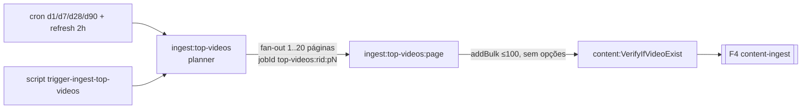
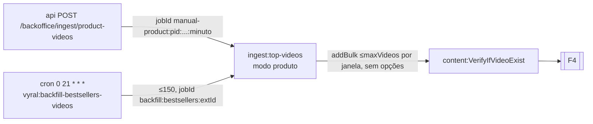
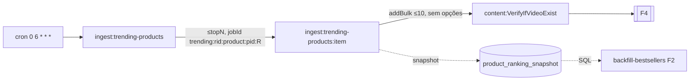
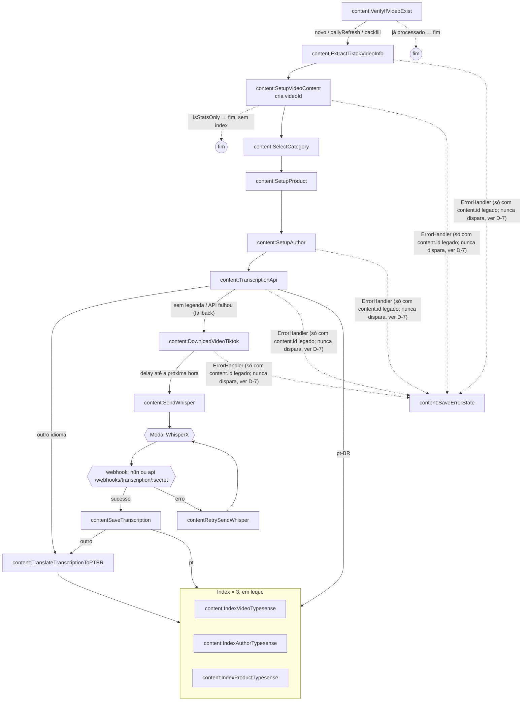
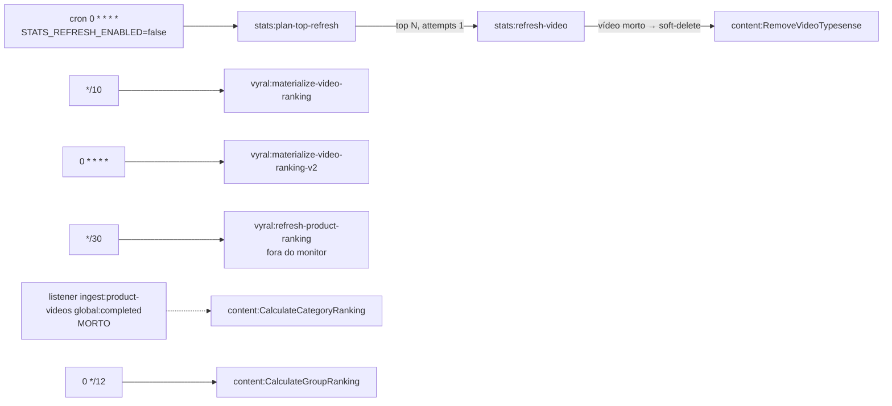
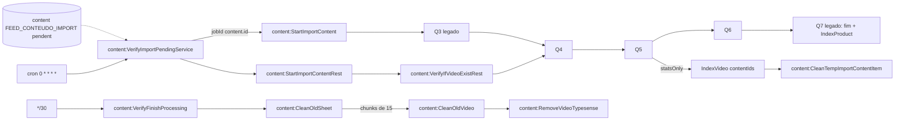

# Vyral: inventário de flows (piloto da 005)

**Data:** 2026-10-16 · **Fonte:** leitura do código de `apps/jobs-processor` (somente leitura) e dos produtores em `apps/api`
**Prefixos:** `JP` = `vyral/workspace/apps/jobs-processor/src`, `API` = `vyral/workspace/apps/api/src`, `WS` = `vyral/workspace`

## 1. Contexto técnico do consumidor

| Item | Estado hoje | Impacto na 005 |
|---|---|---|
| Biblioteca | Bull **4.16.5** via `@nestjs/bull` 10 (NestJS 10). Sem BullMQ, sem `FlowProducer`, sem parent/child | Cobre o caminho Bull do helper; BullMQ fica coberto por teste na lib |
| Nome de job | Todos os jobs sem nome (`__default__`), exceto `_default_` esperado em `contentRetrySendWhisper` | Etapa = fila. Nenhum flow da Vyral precisa de `jobs` na etapa |
| Monitor | `@bull-monitor/express` **5.4.0** em `JP/bull-monitor/internal/bull-monitor.service.ts`, ~46 filas injetadas, ~32 exibidas, **sem `metrics`** | Precisa migrar para `@bull-horizon/express` ≥ 6.6 com `metrics: {}` (as apps `api` e `api-account` já usam bull-horizon) |
| Filas fora do monitor | `content:SaveErrorState`, `content:CleanTempImportContentItem`, `content:CleanOldSheet`, `content:CleanOldVideo`, `vyral:refresh-product-ranking`, `content:BackfillTranslations` e as filas do import legado (comentadas) | Etapa sem fila no monitor vira check `error` na aba Config: registrar todas as filas de flow |
| Retenção | `removeOnComplete: { age: 1800 }`, `removeOnFail: { age: 172800 }` (ou 24h) na maioria dos `add`. **Q3 recebe `addBulk` sem opções** (fica para sempre) | Idade de 30 min é compatível (o collector lê no evento). Sem `true` em lugar nenhum. Q3 sem retenção é um problema da Vyral, não da 005 |
| Correlação | Nenhum trace/correlation id. Só `tiktokId` (do começo ao fim no DTO), `videoId` (a partir do Q5), `content_id` no ramo Whisper, `rankingImportId` só nos planners | `_trace.key` = `tiktokId`; `videoId` como alias de busca |
| jobId | Determinístico só nos planners/páginas/itens; **nenhum jobId do Q3 em diante** | O mesmo vídeo entra em paralelo por d1/d7/d28/d90/refresh/trending/backfill: a busca por chave vai devolver vários traces (US006) |
| HTTP | O jobs-processor não enfileira por HTTP. Quem enfileira por HTTP é o `api` (ingest manual por produto, webhook de transcrição) | `startTrace` / `continueTrace` no `api` também |
| Agentes | Nada de `createAgentRun`. Candidatos: Q10 Translate (OpenAI), `vyral:ExtractViralHooks` (LLM) | Fora da 005; anotado para depois |

## 2. Flows encontrados no código

Nove flows. **F4 é o flow do design** (`content-ingest`); F1 a F3 são as entradas dele.

### F1. Ingestão de feed por região (`feed-ingest`)



| Etapa | Arquivo | Enfileira | Opções |
|---|---|---|---|
| `ingest:top-videos` (região) | `JP/platform/1b.ingest-top-videos/ingest-top-videos.processor.ts:285-303` | `ingest:top-videos:page` × `ceil(maxVideos/pageSize)` | jobId determinístico, 3× exp 10s |
| `ingest:top-videos:page` | `.../ingest-top-videos-page.processor.ts:76-80` | `content:VerifyIfVideoExist` × ≤100 (`addBulk`) | **nenhuma** |

Triggers: crons em `ingest-top-videos.service.ts:58-66` (`30 21 * * *`, `0 21 * * *`, `0 22 * * 1`, `0 23 * * 1`) e `:119-127` (`0 9-23/2 * * *`). Chave do run: `rankingImportId` (não chega ao Q3).

### F2. Ingestão por produto (`product-ingest`)



Arquivos: `API/features/ingest/adapters/queue/ingest.queue.adapter.ts:68`, `JP/platform/backfill-bestsellers-videos/backfill-bestsellers-videos.processor.ts:134-147`, `JP/platform/1b.ingest-top-videos/ingest-top-videos.processor.ts:223`.

### F3. Produtos em tendência (`trending-products`)



Arquivos: `JP/platform/ingest-trending-products/ingest-trending-products.processor.ts:376-379`, `.../ingest-trending-products-item.processor.ts:215`.

### F4. Pipeline por vídeo (`content-ingest`, o flow do design)



| Etapa | Arquivo:linha do `add` | Destino | Opções |
|---|---|---|---|
| Q3 VerifyIfVideoExist | `JP/platform/3-verify-if-video-exist/verify-if-video-exist.service.ts:121` (ingest), `:89` (legado) | Q4 | 3× exp 60s, **sem `await`** |
| Q4 ExtractTiktokVideoInfo | `JP/platform/4-extract-tiktok-video-info/extract-tiktok-video-info.processor.ts:85`, `:107` | Q5 | 3× exp 10s |
| Q5 SetupVideoContent | `JP/platform/5-setup-video-content/setup-video-content.processor.ts:~159` | Q6 (stats-only termina) | 3× exp 10s |
| Q6 SelectCategory | `JP/platform/6-select-category/select-category.processor.ts:123` | Q7 | 3× exp 60s, **sem `await`** |
| Q7 SetupProduct | `JP/platform/7-setup-product/setup-product.processor.ts:236` | Q8 | 3× exp 10s |
| Q8 SetupAuthor | `JP/platform/8-setup-author/setup-author.processor.ts:106` | Q9 | 3× exp 10s |
| Q9 TranscriptionApi | `JP/platform/9-transcription-api/transcription-api.processor.ts:51-55`, `:81`, `:127` | Index ×3 / f-1 / Q10 | 3× exp 10s |
| Q10 Translate | `JP/platform/10-translate-transcription-to-ptbr/translate-transcription-to-ptbr.processor.ts:~204-222` | Index ×3 | 3× exp 10s |
| f-1 DownloadVideoTiktok | `JP/platform/f-1-download-video-tiktok/download-video-tiktok.processor.ts:75-86` | f-2 | `delay` próxima hora, sem attempts |
| f-2 SendWhisper | `JP/platform/f-2-send-whisper/send-whisper.processor.ts:25` | **HTTP para o Modal**, não enfileira | |
| webhook | `API/features/transcriptions/use-cases/base/handle-transcription-callback.use-case.ts:52-66` (e n8n, fora do workspace) | f-4 ou f-3 | jobId `transcription:{status}:{content_id}:{ts}` |
| f-4 contentSaveTranscription | `JP/platform/f-4-save-transcription/save-transcription.processor.ts:86`, `:94-99`, `:135-139` | Index ×3 / Q10 | só `removeOn*` |
| f-3 contentRetrySendWhisper | `JP/platform/f-3-retry-send-whisper/retry-send-whisper.processor.ts:80`, `:96` | HTTP para o Modal | sem backoff nem teto |

Chave de negócio: `tiktokId` existe do Q3 ao Q8 (`video.tiktokId` no DTO); `videoId` (UUID) nasce no Q5 e é o único id do Q9 em diante (`videoId`, `videoIds[0]`, `content_id` no ramo Whisper).

### F5. Stats e materializações



Só `stats-refresh` (PL → RV → RM) é flow de mais de uma etapa. O resto são crons de uma etapa.

### F6. Crons de uma etapa

`ingest:lives` (17:00, desligado por default) e `vyral:ExtractViralHooks` (03:00, LLM). Não enfileiram nada. **Não declarar como flow** (aparecem só na tela Jobs).

### F7. Import legado e limpeza (`legacy-import`, `legacy-cleanup`)



### F8. Traduções

`translations:Schedule` (`*/30`, jobId `contentId`) → `translations:TranslateContent` (LibreTranslate, só linhas legadas). Separado: `content:BackfillTranslations` (manual, ≤2000) → Q10 → Index ×3.

### F9. Operações manuais

`content:ReprocessProcessingVideos` → Q9 (DTO mínimo `{video:{tiktokId}}`); `content:ReprocessAll` → Index ×3 em lotes de 10; `content:ForceReprocessTranscription` → Q4; `content:ForceReprocessImport` → `content:ForceSelectCategory`.

### Filas mortas

`ingest:products`, `ingest:product-videos` (processor em `archive/`, ainda registradas em `refresh-video-ranking.module.ts`), `ingest:echotik:planner`, `ingest:echotik:ranking`, `content:ForceReprocessErrors` (módulo não importado, injeta a fila com typo `contant:ExtractTiktokVideoInfo`), `transcription` (ninguém produz), `content:SaveTranscription` (produzida pelo worker Python, ninguém consome; a real é `contentSaveTranscription`).

## 3. Flows desenhados x código

Sete fontes de "flow desenhado". **D-0 é o design do módulo 05**, o mais importante, porque é o que a tela vai mostrar.

### D-0. `design/05 Flows.dc.html` (`content-ingest`)

| # | Desenho | Código | Tipo |
|---|---|---|---|
| 1 | Q3 "já existe" termina com "só atualiza números" | Já processado **termina sem fazer nada** (salvo `backfill`/`dailyRefresh`). O caminho "só atualiza números" é o `isStatsOnly`, que **segue para Q4 e termina no Q5** | ramo errado |
| 2 | `SetupVideoContent` abre leque para `IndexComments`, `IndexVideoTypesense` e `SelectCategory` | Q5 enfileira **só** `SelectCategory`. `content:IndexComments` **não existe** (nenhuma fila, nenhum processor) | etapa inexistente + leque inexistente |
| 3 | `IndexVideoTypesense → CleanTempImportContentItem` | `CleanTemp` só no índice legado por `contentIds`; nunca para vídeo do ingest | ramo legado |
| 4 | `SetupProduct` e `SetupAuthor` com sidecars `IndexProductTypesense` / `IndexAuthorTypesense` | Sidecars só no caminho legado. No ingest os três índices rodam **juntos no fim** (Q9 pt-BR, Q10, f-4) | posição diferente |
| 5 | Fallback sai de `SetupAuthor` para `DownloadVideoTiktok` | O fallback sai de **`TranscriptionApi`** (sem legenda ou API falhou) | origem errada |
| 6 | `SendWhisper → contentSaveTranscription` direto | f-2 só chama o Modal por HTTP; f-4 é enfileirado pelo **webhook** (n8n ou `api`), com `contentRetrySendWhisper` em loop no erro | elo externo omitido |
| 7 | `TranscriptionApi → Translate` sempre, Translate com `when: language != pt-BR` | pt-BR vai **direto para Index ×3**, pulando Q10 | equivalente (condição no lugar certo seria a aresta) |
| 8 | `Translate → Reindex*Typesense` | Q10 → Index ×3 (Video, Author, Product) | equivalente (3 filas, não uma etapa) |
| 9 | `onError: SaveErrorState` "erro em qualquer etapa" | `ErrorHandlerService` só enfileira com `content.id` **legado** e a condição em `JP/services/error-handler.service.ts:29` (`attemptsMade >= maxAttempts`) **nunca é verdadeira** no Bull 4. A fila não recebe nada do ingest | nó morto |
| 10 | "16 filas declaradas" | O flow real tem 15 filas (sem `IndexComments`, com f-3 e os 3 índices) | contagem |
| 11 | `data._trace` "presente em 98,7% dos jobs" | Nenhum job tem trace | instrumentação ausente (esperado) |

### D-1. `apps/jobs-processor/CLAUDE.md` (Arquitetura)

Desenho: `import → SelectCategory → SetupProduct → ExtractTiktokVideoInfo → SetupAuthor → SetupVideoContent → DownloadVideoTiktok → SendWhisper → SaveTranscription → Translate → IndexVideo`.
Divergências: ordem diferente (código: Q3→Q4→Q5→Q6→Q7→Q8→Q9); falta Q9 TranscriptionApi; Download/Whisper é fallback, não caminho principal; índice são três filas; lista de crons incompleta (faltam top-videos ×5, trending, backfill, refresh-product-ranking, materialize v1/v2, stats, lives); "estágios 5,7,8,9 comentados em `PlatformModule`" é falso (o `main` roda tudo, inclusive f-1); `content:TranscribePyton` no monitor é falso; "~30 filas" virou ~50.

### D-2. `WS/memorys/apps/jobs-processor.md`

Desenho: `1b → 3 → 4 → 5 → 6 → 7 → 8 → 9 → 10 → 14`, ramo de áudio `f-1 → f-2 → f-3 → f-4 → f-5`, "V2 index-first pula Q9–Q12", cron `0 20 UTC`.
Divergências: 3 a 10 batem; 14 (CleanTemp) só no legado; f-3 não é sequencial (só no callback de erro); f-5 não tem processor; "pula Q9–Q12" é falso (Q8 sempre enfileira Q9); `0 20 UTC` é do `ingest:products` arquivado (os crons ativos são 21:00/21:30 diários e 22:00/23:00 às segundas).

### D-3. `JP/platform/CLAUDE.md`

Numeração antiga (`1-`/`2-` foram para `legacy/`, a entrada é `1b`, Translate é `10-`), "comentados" é falso, `f-5-transcribe-pyton-winsper` só tem tipos, `force-reprocess-errors` morto com typo confirmado.

### D-4. Tendências de produtos (`WS/.agents/produtos-tendencia/SPEC.md` §2/§5, `03-jobs-ingest-trending.md`)

Desenho: cron → `newListed(BR, hoje-3, day3_units_sold, top 10)` → produto + snapshot → `videoList(7d, top 10)` → pipeline normal; locks por `(região, data, produto)` e por vídeo.
Divergências: `newListed` nunca é chamado (usa `topSelling` ×2, D-1, até 5 dias para trás); etapas a mais (momentum, gate de credibilidade com `videoList` extra, fill-to-N); `day3UnitsSold` guarda um dia; snapshot com `deleteMany` + upsert em vez de upsert idempotente; locks não implementados; flow extra não desenhado: backfill-bestsellers lê o snapshot e volta para o ingest por produto; a aposentadoria (ST-6) de `refresh-product-ranking` e `CalculateGroupRanking` não aconteceu.

### D-5. EchoTik histórico (`JP/../docs/echotik/README.md`)

Planner → 1 job/dia → ranking → detail → Q3 → … está todo em `archive/1c.ingest-echotik/`, sem módulo importado e sem fila registrada. Restam só os ramos `dto.echotik` em Q5–Q7 (Q7 atrás de flag desligada).

### D-6. Regras de transcrição (memória do workspace)

Desenho: Whisper → callback no jobs-processor → save limpa `metaData transcription*` → bulk 30 min → `translations:TranslateContent`. Código: f-4 grava `vyral.video_transcription` e roteia para Q10 (OpenAI); `translations:*` só pega linhas legadas, órfão para vídeos novos; o callback passa por n8n ou pelo webhook do `api`.

### D-7. Ingest manual por produto (`WS/docs/todo/007-ingestao-manual-por-produto/tasks.md`)

Bate com o código. Ressalvas: `triggerProductVideos` usa `Date.now()`; modo produto fixa `source:'manual'` (backfill também aparece como manual); run vazio sempre `country:'BR'`; T017/T018 abertas.

### Código sem nenhum desenho

`ingest:lives`, stats refresh (com soft-delete → `RemoveVideoTypesense`), `materialize-*`, backfill-bestsellers, `BackfillTranslations`, `ReprocessProcessingVideos`, o ramo `dailyRefresh` (d1, só stats).

### Riscos de perda silenciosa (vão aparecer como `lost`, aresta faltando ou trace parado)

- Q3, Q6, Q7 legado e Q8 legado fazem `queue.add` **sem `await`**: falha no Redis some e o pai conclui.
- f-1 sem `downloadUrls` e Q9 sem `videoId` concluem com sucesso e deixam o vídeo em `processing` até alguém rodar `ReprocessProcessingVideos`.
- `contentRetrySendWhisper` sem teto nem backoff.
- Sem dead-letter: falhas expiram em 24–48 h.

## 4. Definição proposta (segue o código, P9)

Flows a declarar: `feed-ingest` (F1), `product-ingest` (F2), `trending-products` (F3), `content-ingest` (F4), `stats-refresh` (F5), `legacy-import` e `legacy-cleanup` (F7). F6, F8 e F9 ficam fora (uma etapa ou manuais; P7).

```ts
// JP/bull-monitor/flows.ts (novo), compartilhado com os processors
import type { FlowConfig } from '@bull-horizon/root';

export const CONTENT_INGEST: FlowConfig = {
  id: 'content-ingest',
  label: 'Ingestão de conteúdo',
  group: 'Content',
  entry: 'content:VerifyIfVideoExist',
  onError: 'content:SaveErrorState',
  trace: { key: 'video.tiktokId', keyLabel: 'tiktokId', aliases: ['videoId', 'videoIds.0', 'content_id', 'body.content_id'] },
  complete: ['content:IndexVideoTypesense'],
  steps: {
    'content:VerifyIfVideoExist': { description: 'já processado? pula; senão segue', next: [
      { to: 'content:ExtractTiktokVideoInfo', when: 'novo ou refresh' },
      { end: 'já processado', when: 'processed' },
    ] },
    'content:ExtractTiktokVideoInfo': { description: 'scrape do TikTok', next: 'content:SetupVideoContent' },
    'content:SetupVideoContent': { description: 'grava vyral.video (cria videoId)', next: [
      { to: 'content:SelectCategory', when: 'completo' },
      { end: 'só números', when: 'isStatsOnly' },
    ] },
    'content:SelectCategory': { next: 'content:SetupProduct' },
    'content:SetupProduct': { next: 'content:SetupAuthor' },
    'content:SetupAuthor': { next: 'content:TranscriptionApi' },
    'content:TranscriptionApi': { description: 'legenda via EchoTik', next: [
      { to: 'content:IndexVideoTypesense', when: 'pt-BR' },
      { to: 'content:IndexAuthorTypesense', when: 'pt-BR' },
      { to: 'content:IndexProductTypesense', when: 'pt-BR' },
      { to: 'content:TranslateTranscriptionToPTBR', when: 'outro idioma' },
      { to: 'content:DownloadVideoTiktok', when: 'sem legenda', kind: 'fallback' },
    ] },
    'content:DownloadVideoTiktok': { next: { to: 'content:SendWhisper', kind: 'fallback' } },
    'content:SendWhisper': { description: 'Modal WhisperX, volta por webhook', next: [
      { to: 'contentSaveTranscription', when: 'callback ok', kind: 'fallback' },
      { to: 'contentRetrySendWhisper', when: 'callback erro', kind: 'fallback' },
    ] },
    contentRetrySendWhisper: { next: [
      { to: 'contentSaveTranscription', when: 'callback ok', kind: 'fallback' },
      { to: 'contentRetrySendWhisper', when: 'callback erro', kind: 'fallback' },
    ] },
    contentSaveTranscription: { next: [
      { to: 'content:IndexVideoTypesense', when: 'pt' },
      { to: 'content:IndexAuthorTypesense', when: 'pt' },
      { to: 'content:IndexProductTypesense', when: 'pt' },
      { to: 'content:TranslateTranscriptionToPTBR', when: 'outro idioma' },
    ] },
    'content:TranslateTranscriptionToPTBR': { next: [
      'content:IndexVideoTypesense', 'content:IndexAuthorTypesense', 'content:IndexProductTypesense',
    ] },
    'content:IndexVideoTypesense': {},
    'content:IndexAuthorTypesense': {},
    'content:IndexProductTypesense': {},
    'content:SaveErrorState': {},
  },
};
// FEED_INGEST, PRODUCT_INGEST, TRENDING_PRODUCTS, STATS_REFRESH, LEGACY_IMPORT, LEGACY_CLEANUP:
// mesma forma, etapas e arestas das tabelas do §2. FEED/PRODUCT/TRENDING terminam na etapa que
// faz o addBulk para o Q3 (aresta cruzada para content-ingest, ver §5.3). Chave: rankingImportId
// (feed/trending), productId (product), runId (stats).
```

`aliases` e o laço `contentRetrySendWhisper → contentRetrySendWhisper` dependem do que está em `architecture.md` §1.3, §3.4 e §3.5.

## 5. Mudanças de instrumentação no jobs-processor (e no `api`)

Ordem de execução; tudo no repo da Vyral, depois da beta da lib com a 005.

### 5.1 Monitor (`JP/bull-monitor/internal/`)

1. Trocar `@bull-monitor/express`/`root` 5.4.0 por `@bull-horizon/express`/`root` na versão da 005 (`BullAdapter` de `@bull-horizon/root/dist/bull-adapter`).
2. Registrar **todas** as filas dos flows declarados, incluindo as hoje comentadas: `content:SaveErrorState`, `content:CleanTempImportContentItem`, `content:CleanOldSheet`, `content:CleanOldVideo`, `content:RemoveVideoTypesense`, as do import legado, e `vyral:refresh-product-ranking` (injetar no módulo).
3. `group` por área (`Ingest`, `Content`, `Stats`, `Legacy`), igual ao `group` usado em `flows`.
4. Ligar `metrics: {}` (o collector alimenta Flow e Trace) e `flows: [CONTENT_INGEST, FEED_INGEST, ...]`, `flowsOptions: { recentTraces: 20000 }` (P11).
5. Se houver mais de uma réplica do jobs-processor, o monitor (e o collector) roda em todas: avaliar ligar `metrics` só numa (contadores duplicam, ver architecture §4.1).

### 5.2 Entradas (`startTrace`)

| Onde | Mudança |
|---|---|
| `JP/platform/1b.ingest-top-videos/ingest-top-videos.service.ts:58-66`, `:119-127` (repeat) | nada: job de repeat não passa pelo helper; vira trace implícito da entrada (architecture §3.6) |
| `.../ingest-top-videos.processor.ts:285-303` (páginas) | `withTrace(job, pageData, { flow: 'feed-ingest', key: rankingImportId })` |
| `.../ingest-top-videos-page.processor.ts:76-80` (`addBulk` Q3) | cada item: `startTrace(dto, { flow: 'content-ingest', key: dto.video.tiktokId, parent: job })` (novo trace por vídeo, ligado ao job da página) |
| `.../ingest-top-videos.processor.ts:223` (modo produto) | idem, `parent: job` |
| `.../ingest-trending-products.processor.ts:376-379` | `withTrace(job, item, { flow: 'trending-products', key: rankingImportId })` |
| `.../ingest-trending-products-item.processor.ts:215` | `startTrace(dto, { flow: 'content-ingest', key, parent: job })` por vídeo |
| `JP/platform/backfill-bestsellers-videos/...processor.ts:134-147` | `startTrace(data, { flow: 'product-ingest', key: external_id, parent: job })` |
| `API/features/ingest/adapters/queue/ingest.queue.adapter.ts:68` | `startTrace(data, { flow: 'product-ingest', key: productId })` |
| `JP/platform/refresh-top-video-stats/...-planner.processor.ts:46-55` | `withTrace(job, data, { flow: 'stats-refresh', key: runId })` |
| `JP/platform/legacy/.../verify-import-pending*.ts:41,50` | `startTrace(data, { flow: 'legacy-import', key: content.id })` |
| `JP/platform/reprocess-processing-videos/...:78`, `ReprocessAll`, `ForceReprocessTranscription` | `startTrace(data, { flow: 'content-ingest', key })` (entram no meio do flow; aparecem como trace começando em Q9/Q4/Index) |

### 5.3 Elos internos (`withTrace`)

Trocar `queue.add(data, opts)` por `queue.add(withTrace(job, data), opts)` em todos os `add` da tabela do §2/F4: Q3 `:89`/`:121`, Q4 `:85`/`:107`, Q5 `:~159`/`:~280`/`:~284`, Q6 `:90`/`:123`, Q7 `:89`/`:236`, Q8 `:106`/`:123`/`:125`, Q9 `:51-55`/`:81`/`:127`, Q10 `:~204-222`, f-1 `:75-86`/`:116-127`, f-4 `:86`/`:94-99`/`:135-139`, `index-video-typesense.processor.ts:230`, `stats:refresh-video:231`, `clean-old-sheet:117`, `clean-old-videos:92`, `verify-finish-processing:182`, `ErrorHandlerService` `:36` (com `job` do processor). Os processors que delegam para services (Q3) passam o `job` adiante.

Aproveitar e pôr `await` nos `add` de Q3 `:121`, Q6 `:123` e Q7/Q8 legado (hoje a perda é silenciosa; com trace ela aparece como trace parado).

### 5.4 Fronteira externa (Modal → webhook)

O trace se perde no Modal: f-2 manda `{audio_url, content_id, callback_url}` e o webhook enfileira `{body}` sem nada do job de origem.

1. f-1 (`download-video-tiktok.processor.ts:75-86`): incluir `trace: encodeTrace(job)` no payload de f-2 (o `withTrace` já cuida do `_trace` do job f-2).
2. f-2 (`send-whisper.processor.ts:25`) e f-3: acrescentar `?trace=<encodeTrace(job)>` ao `callback_url` enviado ao Modal (o Modal devolve a URL como recebeu; não precisa mudar o Modal).
3. `API/.../handle-transcription-callback.use-case.ts:52-66`: `continueTrace(req.query.trace, { body }, { parentQueue: 'content:SendWhisper' })` antes do `add` em `contentSaveTranscription`/`contentRetrySendWhisper`.
4. n8n (fora do workspace): sem mudança possível aqui. Recomendação: apontar `TRANSCRIPTION_CALLBACK_URL` para o webhook do `api` (P12). Enquanto for n8n, f-4 entra sem `_trace` e é ligado ao trace **só pela busca por chave** (`content_id` = `videoId`, alias).

### 5.5 Retenção

- Nada usa `removeOnComplete: true`: ok.
- `addBulk` para Q3 (páginas, produto, trending item) não tem opções: os jobs nunca saem do Redis. Não bloqueia a 005, mas recomendar `{ removeOnComplete: { age: 1800 }, removeOnFail: { age: 172800 } }` (mesmo padrão das outras etapas).
- Idade de 30 min significa que "Abrir job" de um trace mais velho que isso cai em "job removido": a UI trata (o metadado fica no índice).

### 5.6 Correções que a validação vai apontar (decisão do dono da Vyral, fora da 005)

1. `JP/services/error-handler.service.ts:29`: `attemptsMade >= maxAttempts` nunca é verdadeiro no Bull 4 (usar `attemptsMade >= attempts - 1`, como o Q10). Sem isso o nó ON ERROR fica sempre zerado.
2. `SaveErrorState` só para `content.id` legado: decidir se o ingest (por `videoId`) também registra erro.
3. Atualizar D-1, D-2 e D-3 (docs da Vyral) para o fluxo real, ou gerar a partir da definição do §4.
4. Remover filas mortas e o listener morto de `ingest:product-videos` (deixa `CalculateCategoryRanking` sem produtor).
5. `contentRetrySendWhisper` sem teto: o laço vai aparecer no trace (até `hop` 64).
